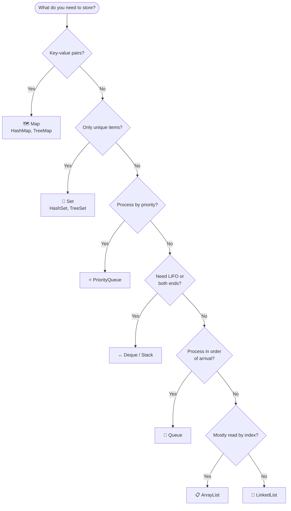

<div align="center">

# ☕ Java Practice

### My journey learning Java: one program at a time

From **Hello World** to the **Collections Framework**, 27 hands-on programs covering the fundamentals.

[](https://openjdk.org/)
[](#-topic-explorer)
[](#-topic-explorer)
[](#-learning-tracker)
[](https://codespaces.new/adeebmansoor/Java)

**👇 Click a topic to jump straight to it**

[👋 Basics](#-basics--numbers) •
[🧮 Methods](#-methods) •
[🔺 Patterns](#-patterns) •
[📦 Arrays](#-arrays) •
[🔍 Search & Sort](#-searching--sorting) •
[🔤 Strings](#-strings) •
[🧬 OOP](#-oop) •
[📚 Collections](#-collections)

</div>

---

## 📖 About

This repo is my personal workspace for learning **Java**. Every file is a small, self-contained program focused on one concept, so you can open it, read it, run it and experiment with it.

> 💡 **How to use this page:** every section below is collapsible. Click a ▶ arrow to expand it, then click any file name to open the code.

---

## 🚀 Quick Start

<details open>
<summary><b>▶ Run any program in 3 steps</b></summary>

<br>

**1. Clone the repo**

```bash
git clone https://github.com/adeebmansoor/Java.git
cd Java
```

**2. Compile a file**

```bash
javac HelloWorld.java
```

**3. Run it**

```bash
java HelloWorld
```

> Replace `HelloWorld` with any file name from the explorer below. No extension is needed when running.

**Prefer an editor?** Open the folder in **VS Code** with the Java extension and press ▶ Run above the `main` method.

**☁️ Don't want to install anything?** Click the badge to code in your browser:

[](https://codespaces.new/adeebmansoor/Java)

</details>

---

## 🗂️ Topic Explorer

### 👋 Basics & Numbers

<details>
<summary><b>▶ 2 programs</b> — your first steps in Java</summary>

<br>

| Program | What it covers |
|---------|----------------|
| [HelloWorld.java](./HelloWorld.java) | The classic first program |
| [numberPrograms.java](./numberPrograms.java) | Common number-based programs |

</details>

### 🧮 Methods

<details>
<summary><b>▶ 4 programs</b> — writing and calling methods</summary>

<br>

| Program | What it covers |
|---------|----------------|
| [MethodsAddition.java](./MethodsAddition.java) | Methods that add numbers |
| [MethodsEven_Odd.java](./MethodsEven_Odd.java) | Even and odd checks with methods |
| [MethodsQuestions.java](./MethodsQuestions.java) | Method practice questions |
| [QFunctions_Methods.java](./QFunctions_Methods.java) | More function and method questions |

</details>

### 🔺 Patterns

<details>
<summary><b>▶ 3 programs</b> — printing stars, numbers and shapes with loops</summary>

<br>

| Program | What it covers |
|---------|----------------|
| [Patterns.java](./Patterns.java) | Pattern printing, set 1 |
| [Patterns2.java](./Patterns2.java) | Pattern printing, set 2 |
| [Patterns3.java](./Patterns3.java) | Pattern printing, set 3 |

</details>

### 📦 Arrays

<details>
<summary><b>▶ 2 programs</b> — working with arrays</summary>

<br>

| Program | What it covers |
|---------|----------------|
| [Arrays.java](./Arrays.java) | Array basics and operations |
| [QArrays.java](./QArrays.java) | Array practice questions |

</details>

### 🔍 Searching & Sorting

<details>
<summary><b>▶ 3 programs</b> — finding and ordering data</summary>

<br>

| Program | Idea | Time complexity |
|---------|------|:---------------:|
| [LinearSearch.java](./LinearSearch.java) | Check every element one by one | O(n) |
| [BinarySearch.java](./BinarySearch.java) | Halve a sorted array each step | O(log n) |
| [BubbleSort.java](./BubbleSort.java) | Swap neighbors until sorted | O(n²) |

> Binary search only works on **sorted** data.

</details>

### 🔤 Strings

<details>
<summary><b>▶ 4 programs</b> — text handling and string methods</summary>

<br>

| Program | What it covers |
|---------|----------------|
| [Strings.java](./Strings.java) | String basics |
| [StringsMethods.java](./StringsMethods.java) | Built-in `String` methods |
| [StringsMethodsQues.java](./StringsMethodsQues.java) | String method practice questions |
| [QStrings.java](./QStrings.java) | More string questions |

</details>

### 🧬 OOP

<details>
<summary><b>▶ 1 program</b> — object-oriented programming</summary>

<br>

| Program | What it covers |
|---------|----------------|
| [InheritanceOops.java](./InheritanceOops.java) | Inheritance and core OOP ideas |

</details>

### 📚 Collections

<details>
<summary><b>▶ 8 programs</b> — the Java Collections Framework</summary>

<br>

| Program | Collection | Best for |
|---------|-----------|----------|
| [CollectionArrayList.java](./CollectionArrayList.java) | `ArrayList` | Fast access by index |
| [CollectionLinkedList.java](./CollectionLinkedList.java) | `LinkedList` | Frequent inserts and removals |
| [CollectionStack.java](./CollectionStack.java) | `Stack` | Last-in, first-out (LIFO) |
| [CollectionQueue.java](./CollectionQueue.java) | `Queue` | First-in, first-out (FIFO) |
| [CollectionDeque.java](./CollectionDeque.java) | `Deque` | Adding or removing at both ends |
| [CollectionPriorityQueue.java](./CollectionPriorityQueue.java) | `PriorityQueue` | Processing by priority |
| [CollectionSet.java](./CollectionSet.java) | `Set` | Unique elements only |
| [CollectionMap.java](./CollectionMap.java) | `Map` | Key-value pairs |

</details>

---

## 🧭 Which Collection Should I Use?

<details open>
<summary><b>▶ Click to expand the decision guide</b></summary>

<br>



</details>

<details>
<summary><b>▶ Collections cheat sheet</b></summary>

<br>

| Collection | Ordered? | Duplicates? | Key idea |
|------------|:--------:|:-----------:|----------|
| `ArrayList` | ✅ | ✅ | Resizable array, quick `get(i)` |
| `LinkedList` | ✅ | ✅ | Quick add/remove at the ends |
| `Stack` | ✅ | ✅ | `push` and `pop` (LIFO) |
| `Queue` | ✅ | ✅ | `offer` and `poll` (FIFO) |
| `Deque` | ✅ | ✅ | Add and remove at both ends |
| `PriorityQueue` | By priority | ✅ | Smallest element comes out first by default |
| `HashSet` | ❌ | ❌ | Fast lookups, no order |
| `TreeSet` | Sorted | ❌ | Always kept sorted |
| `HashMap` | ❌ | Unique keys | Fast key lookups |
| `TreeMap` | Sorted by key | Unique keys | Keys kept sorted |

> 💡 For a stack in modern Java, many developers prefer `ArrayDeque` over the older `Stack` class.

</details>

---

## ✅ Learning Tracker

<details open>
<summary><b>▶ Where I am on the roadmap</b></summary>

<br>

- [x] Hello World and basic programs
- [x] Number programs
- [x] Methods
- [x] Pattern printing
- [x] Arrays
- [x] Searching and sorting basics
- [x] Strings and string methods
- [x] Inheritance
- [x] Collections: List, Stack, Queue, Deque, PriorityQueue, Set, Map
- [ ] Polymorphism, abstraction and encapsulation
- [ ] Interfaces and abstract classes
- [ ] Exception handling
- [ ] Generics
- [ ] File I/O
- [ ] Lambdas and Streams
- [ ] Multithreading
- [ ] More sorting algorithms (selection, insertion, merge, quick)

</details>

---

## 📁 Project Structure

<details>
<summary><b>▶ Click to expand the file tree</b></summary>

<br>

```text
Java/
├── .vscode/
│   └── launch.json
│
├── HelloWorld.java
├── numberPrograms.java
│
├── MethodsAddition.java
├── MethodsEven_Odd.java
├── MethodsQuestions.java
├── QFunctions_Methods.java
│
├── Patterns.java
├── Patterns2.java
├── Patterns3.java
│
├── Arrays.java
├── QArrays.java
│
├── LinearSearch.java
├── BinarySearch.java
├── BubbleSort.java
│
├── Strings.java
├── StringsMethods.java
├── StringsMethodsQues.java
├── QStrings.java
│
├── InheritanceOops.java
│
├── CollectionArrayList.java
├── CollectionLinkedList.java
├── CollectionStack.java
├── CollectionQueue.java
├── CollectionDeque.java
├── CollectionPriorityQueue.java
├── CollectionSet.java
├── CollectionMap.java
│
└── README.md
```

</details>

---

## 🤝 Connect

**Adeeb Mansoor**

[](https://github.com/adeebmansoor/)

---

<div align="center">

⭐ If this repo helps you learn, drop a star!

*Code a little every day.* ☕

</div>
